# Byzantine erasure storage

The [matched Hyperfine comparison](docs/read-reuse-benchmark.md) measured a warm 1 MiB complete-CLI read at **336 ms median versus 485 ms baseline (30.7% lower)** across five alternating pairs on one four-server loopback host. All 30 timed outputs matched exactly. Small-file timings showed no clear gain, and 1 MiB median peak RSS increased 4.1%. This measures one reader including startup and fsync; it does not establish loaded throughput, p99 or WAN performance.

This repository preserves the full Tahoe-LAFS source tree and Git history at upstream revision [`f002fd0d27d9a3da5c0da162b10725838353bd63`](https://github.com/tahoe-lafs/tahoe-lafs/tree/f002fd0d27d9a3da5c0da162b10725838353bd63). The original [Tahoe README](README.rst), source files, and both upstream license texts remain in place. The coursework code is a separate, bounded protocol experiment under [`bfr/`](bfr/) that imports Tahoe's `CRSEncoder` and `CRSDecoder`; it does not claim to modify Tahoe's grid protocol.

The experiment stores one signed file history across four disk-backed loopback servers. With `n=4`, `b=1`, and `f=2`, it uses two Tahoe erasure shares to reconstruct a stripe, requires three distinct acknowledgments for a mutation, and requires three metadata responses with two matching signed heads. Each owner signs its version history and each stripe's four share digests. The reader verifies those signatures and pins the accepted history in its own persistent state.

## Architecture and execution guide

<!-- execution-flow:start -->
### Execution flow

Start with the primary path, then expand a detailed workflow. Select a numbered node to see its operation, implementation techniques, and source. Solid arrows show the named control, data, or lifecycle handoff; dotted arrows show error paths. Separate entry points are named in each workflow.

<a id="review-walkthrough"></a>

#### Walk through one concrete example

Read the current signed version of a file through the configured loopback CLI while a reader checkpoint is present.

**Trace.** [Validate loopback CLI inputs](#flow-step-cli-boundary) → [Collect metadata replies and choose witnessed head](#flow-step-metadata-head-quorum) → [Check and save monotonic reader checkpoint](#flow-step-checkpoint-save) → [Fetch and verify shares per stripe](#flow-step-read-fetch-reuse) → [Decode two distinct shares per stripe](#flow-step-decode-read).

**Result and boundary.** The client validates the CLI request, chooses a witnessed metadata head, checks and saves the monotonic reader checkpoint, then fetches and verifies shares per stripe and decodes from two distinct shares. A stripe without two valid shares ends in a read failure rather than returning incomplete bytes.

<details>
<summary>Implementation decisions to explain</summary>

**Why save a reader checkpoint after choosing a metadata head?** The checkpoint records monotonic reader history so a later read can detect stale or regressing metadata. It introduces persistent reader state that must be checked as part of the read boundary.

[Monotonic reader-history checkpoint](#technique-reader-checkpoint).

**Why does each stripe need two distinct valid shares?** The encoded stripe is reconstructed from two distinct verified shares, while signatures and manifests bind the share data to its owner-signed history. Requiring both means reads stop when a stripe has insufficient valid shares.

[Tahoe CRS encoding in bounded stripes](#technique-erasure-signed-stripes).

</details>

#### Primary execution flow

The client CLI routes a mutation into signed, erasure-coded pending state before delivery, or routes a read through metadata quorum, checkpoint validation, signed share checks and two-share decoding. Retry and repair are separate recovery entries; the verification and measurement drivers are independent workflows.

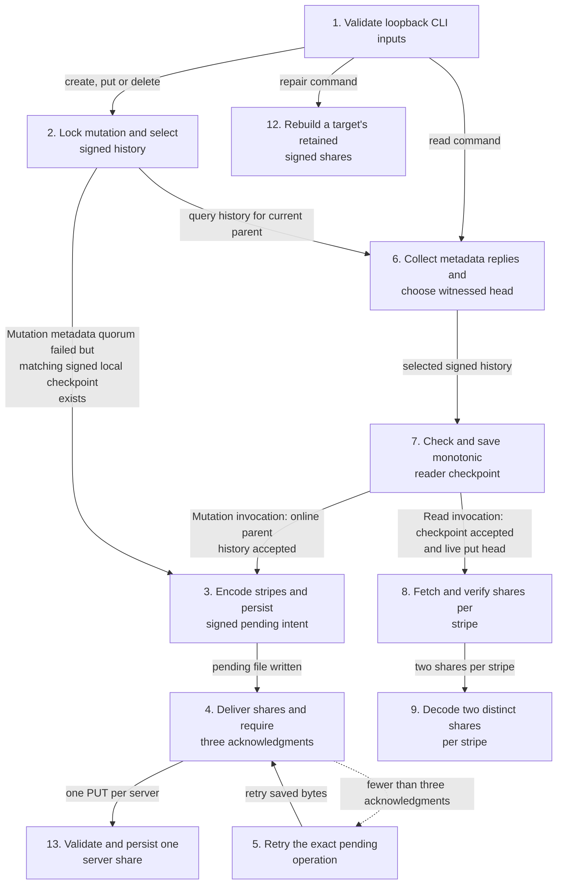

**Detailed workflows.** [Write a signed file version](#flow-workflow-mutation-and-retry) · [Read a signed version](#flow-workflow-read-and-checkpoint) · [Repair a stale server](#flow-workflow-repair) · [Verify protocol and process lifecycle](#flow-workflow-verification) · [Verify read response reuse](#flow-workflow-read-reuse-proof) · [Compare and measure read workloads](#flow-workflow-measurements) · [Identity, listing and service entries](#flow-workflow-identity-list-service).

<a id="flow-workflow-mutation-and-retry"></a>

<details>
<summary>Write a signed file version</summary>

Starts at create or put in the client CLI. The mutation lock protects local state, a pending exact update is saved before delivery, and fewer than three acknowledgments leaves it for retry.

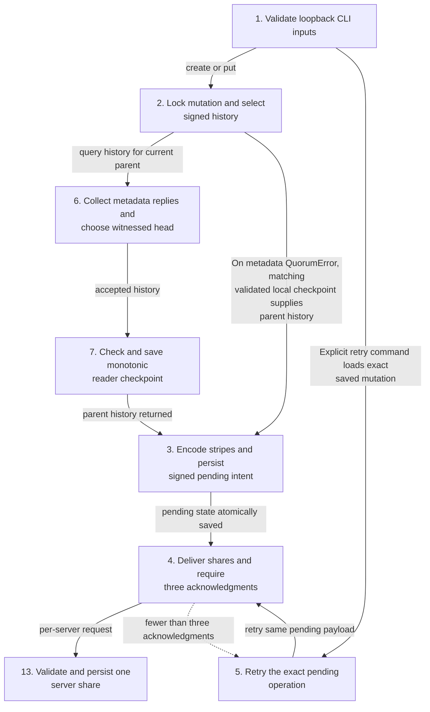

</details>

<a id="flow-workflow-read-and-checkpoint"></a>

<details>
<summary>Read a signed version</summary>

Starts at the reader CLI command with its owner key pinned in trusted local state. Three server responses are required before choosing a witnessed head; the reader then checks its checkpoint and decodes from two distinct verified shares per stripe.

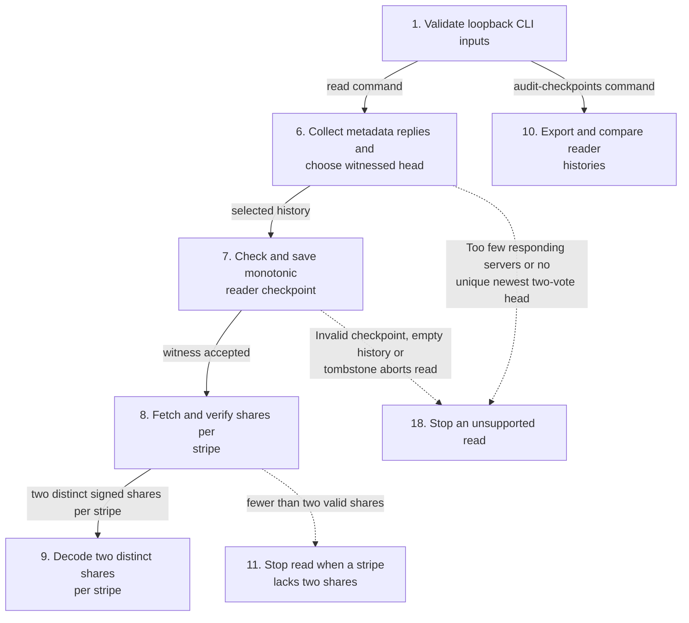

</details>

<a id="flow-workflow-repair"></a>

<details>
<summary>Repair a stale server</summary>

Starts at the repair CLI command. It first requires quorum history and a checkpoint that does not roll back, then reconstructs retained versions from authenticated peer shares and installs each target payload. Distinct client locks may nest only where code does so; checkpoint lock is separate from mutation lock.

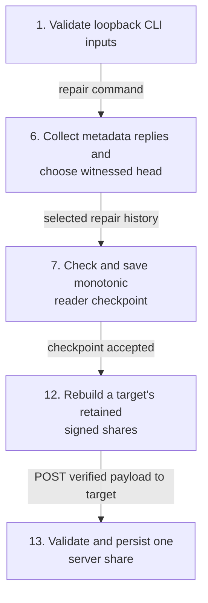

</details>

<a id="flow-workflow-verification"></a>

<details>
<summary>Verify protocol and process lifecycle</summary>

An independent driver launches and health-checks four owned loopback servers, runs normal and faulted CLI journeys, records evidence and removes owned scratch/processes. Protocol tests provide deterministic adversarial checks; they do not extend the runtime flow.

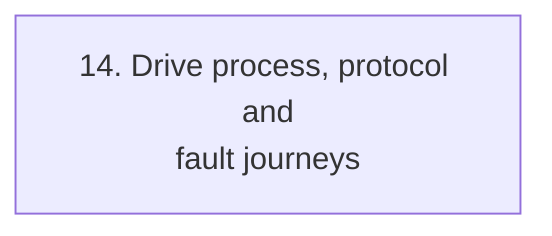

</details>

<a id="flow-workflow-read-reuse-proof"></a>

<details>
<summary>Verify read response reuse</summary>

A separate focused driver exercises real HTTP and Tahoe decoding, then checks exact bytes and request counts. It verifies behavior, not timing.

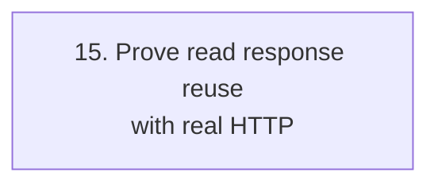

</details>

<a id="flow-workflow-measurements"></a>

<details>
<summary>Compare and measure read workloads</summary>

Two independent drivers measure different questions. Hyperfine compares matched baseline/candidate CLI reads; the scheduled-load driver classifies bounded outcomes under its offered rates. Their measurements do not prove production capacity.

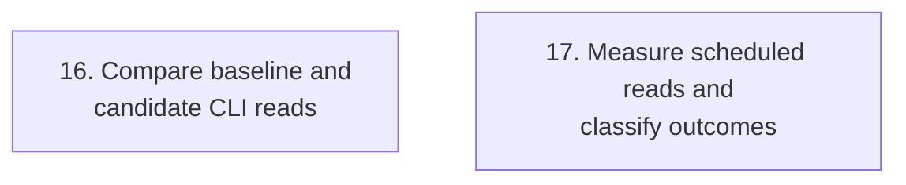

</details>

<a id="flow-workflow-identity-list-service"></a>

<details>
<summary>Identity, listing and service entries</summary>

Independent CLI modes. Identity commands use local state; listing contacts metadata services; server starts a separately owned listener.

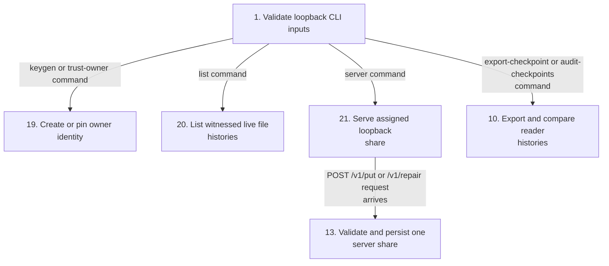

</details>

#### Steps, techniques, and source

These source traces cover the active scope below. They explain implementation behavior; benchmark results and their limits remain in the measurement sections.

<a id="flow-step-cli-boundary"></a>

##### 1. Validate loopback CLI inputs

**Component.** scripts/bfr.py and bfr.client._urls. The CLI dispatches server startup and checkpoint auditing before state validation, then keygen and trust-owner before URL validation. Other client commands require exactly four distinct-port plain HTTP loopback URLs. Server startup separately rejects non-loopback binds.

**Techniques at this step.** [Loopback-only CLI and service boundary](#technique-loopback-cli-boundary).

**Source.** [`scripts/bfr.py:25`](https://github.com/STEVVVU/byzantine-erasure-storage/blob/master/scripts/bfr.py#L25) · [`scripts/bfr.py:68`](https://github.com/STEVVVU/byzantine-erasure-storage/blob/master/scripts/bfr.py#L68) · [`bfr/client.py:115`](https://github.com/STEVVVU/byzantine-erasure-storage/blob/master/bfr/client.py#L115) · [`bfr/server.py:236`](https://github.com/STEVVVU/byzantine-erasure-storage/blob/master/bfr/server.py#L236). [Back to execution flow](#execution-flow).

<a id="flow-step-mutation-lock-history"></a>

##### 2. Lock mutation and select signed history

**Component.** bfr.client.put, _mutation_lock and _history_for_write. put and delete hold a per-owner/file mutation OS lock while selecting signed metadata history and preparing delivery. On metadata QuorumError, _history_for_write can return a matching validated signed local checkpoint. Online history and successful delivery update checkpoints while holding the mutation lock and acquiring the distinct checkpoint lock.

**Techniques at this step.** [Per-file mutation and checkpoint locks](#technique-per-file-locking) · [Metadata response and head quorum](#technique-metadata-quorum).

**Source.** [`bfr/client.py:179`](https://github.com/STEVVVU/byzantine-erasure-storage/blob/master/bfr/client.py#L179) · [`bfr/client.py:278`](https://github.com/STEVVVU/byzantine-erasure-storage/blob/master/bfr/client.py#L278). [Back to execution flow](#execution-flow).

<a id="flow-step-encode-sign-persist"></a>

##### 3. Encode stripes and persist signed pending intent

**Component.** bfr.client._put_locked, bfr.codec and bfr.model. The client encodes nonempty chunks up to 128 KiB as Tahoe CRS n=4,k=2 shares, signs each share digest and the versioned parent-linked manifest, then validates it. It atomically saves the complete history, signed update and exact per-server share bytes before sending requests. Delete instead signs a tombstone with no stripes and saves pending state through the same delivery path.

**Techniques at this step.** [Tahoe CRS encoding in bounded stripes](#technique-erasure-signed-stripes) · [Owner-signed single-writer version chain](#technique-owner-signed-history) · [Signed share-manifest verification](#technique-signed-share-manifest) · [Bounded canonical record validation](#technique-bounded-record-validation) · [Persist exact mutation before delivery](#technique-pending-before-send).

**Source.** [`bfr/client.py:339`](https://github.com/STEVVVU/byzantine-erasure-storage/blob/master/bfr/client.py#L339) · [`bfr/codec.py:14`](https://github.com/STEVVVU/byzantine-erasure-storage/blob/master/bfr/codec.py#L14) · [`bfr/model.py:76`](https://github.com/STEVVVU/byzantine-erasure-storage/blob/master/bfr/model.py#L76) · [`bfr/model.py:95`](https://github.com/STEVVVU/byzantine-erasure-storage/blob/master/bfr/model.py#L95) · [`bfr/client.py:403`](https://github.com/STEVVVU/byzantine-erasure-storage/blob/master/bfr/client.py#L403). [Back to execution flow](#execution-flow).

<a id="flow-step-deliver-acks"></a>

##### 4. Deliver shares and require three acknowledgments

**Component.** bfr.client._deliver and bfr.server.Handler._install_unlocked. The client sends one signed history/update and the assigned share to each server. Servers validate signed history and this server's share digest, serialize installation per file, and persist share and metadata; the client clears pending state only after three distinct valid acknowledgments and checkpoint persistence.

**Techniques at this step.** [Persist exact mutation before delivery](#technique-pending-before-send) · [Per-file mutation and checkpoint locks](#technique-per-file-locking).

**Source.** [`bfr/client.py:377`](https://github.com/STEVVVU/byzantine-erasure-storage/blob/master/bfr/client.py#L377) · [`bfr/server.py:152`](https://github.com/STEVVVU/byzantine-erasure-storage/blob/master/bfr/server.py#L152). [Back to execution flow](#execution-flow).

<a id="flow-step-uncertain-retry"></a>

##### 5. Retry the exact pending operation

**Component.** bfr.client.retry and _retry_locked. If fewer than three acknowledgments arrive, _deliver raises UncertainCommit and leaves the pending file. retry acquires the same mutation lock, validates the saved update and history, then resends the saved update and share bytes; success checkpoints history and removes the pending file.

**Techniques at this step.** [Persist exact mutation before delivery](#technique-pending-before-send) · [Per-file mutation and checkpoint locks](#technique-per-file-locking).

**Source.** [`bfr/client.py:395`](https://github.com/STEVVVU/byzantine-erasure-storage/blob/master/bfr/client.py#L395) · [`bfr/client.py:442`](https://github.com/STEVVVU/byzantine-erasure-storage/blob/master/bfr/client.py#L442) · [`bfr/client.py:450`](https://github.com/STEVVVU/byzantine-erasure-storage/blob/master/bfr/client.py#L450). [Back to execution flow](#execution-flow).

<a id="flow-step-metadata-head-quorum"></a>

##### 6. Collect metadata replies and choose witnessed head

**Component.** bfr.client._history_votes. The client requires three responding servers, validates each signed history, groups replies by exact head hash, and selects the newest version supported by at least two replies. It rejects no qualifying head or multiple divergent heads at the newest witnessed version.

**Techniques at this step.** [Metadata response and head quorum](#technique-metadata-quorum) · [Owner-signed single-writer version chain](#technique-owner-signed-history) · [Bounded canonical record validation](#technique-bounded-record-validation).

**Source.** [`bfr/client.py:192`](https://github.com/STEVVVU/byzantine-erasure-storage/blob/master/bfr/client.py#L192). [Back to execution flow](#execution-flow).

<a id="flow-step-checkpoint-save"></a>

##### 7. Check and save monotonic reader checkpoint

**Component.** bfr.client._history_checkpoint and bfr.model.validate_checkpoint. Under a separate per-file checkpoint OS lock, the client validates the current signed chain against saved owner, file, head and prefix hashes, then atomically saves the longer chain. An empty server history cannot erase a saved checkpoint.

**Techniques at this step.** [Monotonic reader-history checkpoint](#technique-reader-checkpoint) · [Per-file mutation and checkpoint locks](#technique-per-file-locking).

**Source.** [`bfr/client.py:253`](https://github.com/STEVVVU/byzantine-erasure-storage/blob/master/bfr/client.py#L253) · [`bfr/model.py:187`](https://github.com/STEVVVU/byzantine-erasure-storage/blob/master/bfr/model.py#L187). [Back to execution flow](#execution-flow).

<a id="flow-step-read-fetch-reuse"></a>

##### 8. Fetch and verify shares per stripe

**Component.** bfr.client.read and _collect_shares. After metadata quorum and checkpoint validation, read requests each stripe from the selected signed version. Within this read only, a successfully verified full server response is reused for later stripes; each stripe rechecks its update, server share ID, digest and owner signature, and evicts a response rejected for that stripe.

**Techniques at this step.** [Read-local full-response reuse with per-stripe checks](#technique-read-local-response-reuse) · [Signed share-manifest verification](#technique-signed-share-manifest) · [Metadata response and head quorum](#technique-metadata-quorum).

**Source.** [`bfr/client.py:486`](https://github.com/STEVVVU/byzantine-erasure-storage/blob/master/bfr/client.py#L486) · [`bfr/client.py:314`](https://github.com/STEVVVU/byzantine-erasure-storage/blob/master/bfr/client.py#L314) · [`bfr/client.py:305`](https://github.com/STEVVVU/byzantine-erasure-storage/blob/master/bfr/client.py#L305). [Back to execution flow](#execution-flow).

<a id="flow-step-decode-read"></a>

##### 9. Decode two distinct shares per stripe

**Component.** bfr.client._decode_stripes and bfr.codec.decode_data. The client requires at least two distinct valid shares for every stripe, selects two IDs, decodes with Tahoe CRS, joins chunks and truncates to the signed file size. The CLI atomically writes the completed bytes only after read returns.

**Techniques at this step.** [Tahoe CRS encoding in bounded stripes](#technique-erasure-signed-stripes).

**Source.** [`bfr/client.py:370`](https://github.com/STEVVVU/byzantine-erasure-storage/blob/master/bfr/client.py#L370) · [`bfr/codec.py:26`](https://github.com/STEVVVU/byzantine-erasure-storage/blob/master/bfr/codec.py#L26) · [`scripts/bfr.py:91`](https://github.com/STEVVVU/byzantine-erasure-storage/blob/master/scripts/bfr.py#L91). [Back to execution flow](#execution-flow).

<a id="flow-step-checkpoint-exchange"></a>

##### 10. Export and compare reader histories

**Component.** bfr.client.export_checkpoint, audit_checkpoints and bfr.model.checkpoint_relation. A reader can export its saved signed checkpoint. The audit command validates both checkpoint chains and reports same, extension, or divergent history; the CLI exits with code 2 for divergence.

**Techniques at this step.** [Monotonic reader-history checkpoint](#technique-reader-checkpoint).

**Source.** [`bfr/client.py:578`](https://github.com/STEVVVU/byzantine-erasure-storage/blob/master/bfr/client.py#L578) · [`bfr/client.py:589`](https://github.com/STEVVVU/byzantine-erasure-storage/blob/master/bfr/client.py#L589) · [`bfr/model.py:172`](https://github.com/STEVVVU/byzantine-erasure-storage/blob/master/bfr/model.py#L172) · [`scripts/bfr.py:74`](https://github.com/STEVVVU/byzantine-erasure-storage/blob/master/scripts/bfr.py#L74). [Back to execution flow](#execution-flow).

<a id="flow-step-read-quorum-failure"></a>

##### 11. Stop read when a stripe lacks two shares

**Component.** bfr.client._collect_shares. If fewer than two distinct signed shares validate for a stripe, _collect_shares raises QuorumError. read does not call the decoder or return output bytes.

This is the terminal error branch of the existing two-share threshold.

**Source.** [`bfr/client.py:333`](https://github.com/STEVVVU/byzantine-erasure-storage/blob/master/bfr/client.py#L333). [Back to execution flow](#execution-flow).

<a id="flow-step-repair-peer-shares"></a>

##### 12. Rebuild a target's retained signed shares

**Component.** bfr.client.repair and _repair_payloads. Repair obtains and checkpoints the metadata history before RPCs, then processes retained versions with the head first. For each put stripe it fetches at least two validated server shares, decodes and re-encodes them, checks the target bytes against the original signed manifest, then sends the verified payload to the target.

**Techniques at this step.** [Authenticated repair with ordered atomic installation](#technique-authenticated-repair) · [Tahoe CRS encoding in bounded stripes](#technique-erasure-signed-stripes) · [Monotonic reader-history checkpoint](#technique-reader-checkpoint) · [Signed share-manifest verification](#technique-signed-share-manifest).

**Source.** [`bfr/client.py:555`](https://github.com/STEVVVU/byzantine-erasure-storage/blob/master/bfr/client.py#L555) · [`bfr/client.py:533`](https://github.com/STEVVVU/byzantine-erasure-storage/blob/master/bfr/client.py#L533) · [`bfr/client.py:516`](https://github.com/STEVVVU/byzantine-erasure-storage/blob/master/bfr/client.py#L516). [Back to execution flow](#execution-flow).

<a id="flow-step-server-install"></a>

##### 13. Validate and persist one server share

**Component.** bfr.server.Handler.do_POST and _install_unlocked. The loopback server accepts bounded JSON, verifies the owner-signed update and supplied history, checks the assigned share's length and digest, serializes installs per file, and rejects conflicting history. It atomically writes share bytes before publishing metadata and prunes share files older than the latest eight versions.

**Techniques at this step.** [Bounded canonical record validation](#technique-bounded-record-validation) · [Signed share-manifest verification](#technique-signed-share-manifest) · [Per-file mutation and checkpoint locks](#technique-per-file-locking) · [Persist exact mutation before delivery](#technique-pending-before-send).

**Source.** [`bfr/server.py:131`](https://github.com/STEVVVU/byzantine-erasure-storage/blob/master/bfr/server.py#L131) · [`bfr/server.py:143`](https://github.com/STEVVVU/byzantine-erasure-storage/blob/master/bfr/server.py#L143) · [`bfr/server.py:152`](https://github.com/STEVVVU/byzantine-erasure-storage/blob/master/bfr/server.py#L152). [Back to execution flow](#execution-flow).

<a id="flow-step-verify-journey"></a>

##### 14. Drive process, protocol and fault journeys

**Component.** scripts.verify.Run. The verifier launches four owned loopback servers, checks their PIDs and health, then drives independent owner and reader flows plus rollback, stale-share, repair, quorum and exact-retry faults. It records evidence, stops only owned processes, removes scratch data and retains evidence.

**Techniques at this step.** [Full-byte, signed-history, and adversarial oracles](#technique-byte-history-adversarial-oracles) · [Loopback-only CLI and service boundary](#technique-loopback-cli-boundary).

**Source.** [`scripts/verify.py:60`](https://github.com/STEVVVU/byzantine-erasure-storage/blob/master/scripts/verify.py#L60) · [`scripts/verify.py:136`](https://github.com/STEVVVU/byzantine-erasure-storage/blob/master/scripts/verify.py#L136) · [`scripts/verify.py:192`](https://github.com/STEVVVU/byzantine-erasure-storage/blob/master/scripts/verify.py#L192) · [`scripts/verify.py:325`](https://github.com/STEVVVU/byzantine-erasure-storage/blob/master/scripts/verify.py#L325). [Back to execution flow](#execution-flow).

<a id="flow-step-request-proof"></a>

##### 15. Prove read response reuse with real HTTP

**Component.** scripts/verify_read_requests.py. The focused driver starts the real loopback service and CLI, reads a 1 MiB file, verifies exact output bytes and checks request counts. This verifies response reuse behavior; it does not establish a performance gain.

**Techniques at this step.** [Read-local full-response reuse with per-stripe checks](#technique-read-local-response-reuse) · [Full-byte, signed-history, and adversarial oracles](#technique-byte-history-adversarial-oracles).

**Source.** [`scripts/verify_read_requests.py:17`](https://github.com/STEVVVU/byzantine-erasure-storage/blob/master/scripts/verify_read_requests.py#L17). [Back to execution flow](#execution-flow).

<a id="flow-step-paired-cli-measurement"></a>

##### 16. Compare baseline and candidate CLI reads

**Component.** scripts.compare_read_reuse. The comparison requires a clean candidate distinct from its frozen baseline and matching shared protocol/server files. It performs one warmup and five alternating Hyperfine pairs at each size, validates output bytes each time, and retains timings and cleanup receipts.

**Techniques at this step.** [Alternating complete-CLI comparison with byte gates](#technique-paired-cli-measurement).

**Source.** [`scripts/compare_read_reuse.py:39`](https://github.com/STEVVVU/byzantine-erasure-storage/blob/master/scripts/compare_read_reuse.py#L39) · [`scripts/compare_read_reuse.py:76`](https://github.com/STEVVVU/byzantine-erasure-storage/blob/master/scripts/compare_read_reuse.py#L76). [Back to execution flow](#execution-flow).

<a id="flow-step-scheduled-load-measurement"></a>

##### 17. Measure scheduled reads and classify outcomes

**Component.** scripts.benchmark. The benchmark runs finite scheduled and closed-loop read cells against four disk-backed servers, separates exact completions, expected two-server metadata-quorum rejections, other errors and timeouts, and validates bytes for completions. These bounded loopback batches do not establish sustainable service capacity or production latency.

**Techniques at this step.** [Scheduled-arrival benchmark with outcome gates](#technique-scheduled-load-outcome-gates).

**Source.** [`scripts/benchmark.py:37`](https://github.com/STEVVVU/byzantine-erasure-storage/blob/master/scripts/benchmark.py#L37) · [`scripts/benchmark.py:119`](https://github.com/STEVVVU/byzantine-erasure-storage/blob/master/scripts/benchmark.py#L119). [Back to execution flow](#execution-flow).

<a id="flow-step-metadata-read-failure"></a>

##### 18. Stop an unsupported read

**Component.** read. Metadata quorum or checkpoint validation errors abort read. Empty history or a selected delete tombstone raises FileNotFoundError before any share collection or output publication.

Explicit CLI operation or error boundary.

**Source.** [`bfr/client.py:487`](https://github.com/STEVVVU/byzantine-erasure-storage/blob/master/bfr/client.py#L487). [Back to execution flow](#execution-flow).

<a id="flow-step-identity-local"></a>

##### 19. Create or pin owner identity

**Component.** initialize. keygen generates an Ed25519 owner key and public identity in local state; trust-owner validates and pins a supplied 32-byte public key under its derived owner ID. These commands do not contact servers.

**Techniques at this step.** [Owner-signed single-writer version chain](#technique-owner-signed-history).

**Source.** [`bfr/client.py:63`](https://github.com/STEVVVU/byzantine-erasure-storage/blob/master/bfr/client.py#L63). [Back to execution flow](#execution-flow).

<a id="flow-step-list-files"></a>

##### 20. List witnessed live file histories

**Component.** list_files. list_files collects at least three server listings, unions advertised file IDs and separately selects signed metadata history for each ID. Files lacking metadata quorum are skipped; accepted histories are checkpointed and only put heads are returned.

**Techniques at this step.** [Metadata response and head quorum](#technique-metadata-quorum) · [Monotonic reader-history checkpoint](#technique-reader-checkpoint).

**Source.** [`bfr/client.py:505`](https://github.com/STEVVVU/byzantine-erasure-storage/blob/master/bfr/client.py#L505). [Back to execution flow](#execution-flow).

<a id="flow-step-server-start"></a>

##### 21. Serve assigned loopback share

**Component.** serve. The server validates a loopback bind and share ID, initializes per-file locks and starts ThreadingHTTPServer. GET routes health, listing, metadata and version shares; POST put and repair invoke the validated installation path.

**Techniques at this step.** [Loopback-only CLI and service boundary](#technique-loopback-cli-boundary).

**Source.** [`bfr/server.py:236`](https://github.com/STEVVVU/byzantine-erasure-storage/blob/master/bfr/server.py#L236). [Back to execution flow](#execution-flow).

<details>
<summary>Scope and subsystem coverage</summary>

BFR single-owner client mutations, signed metadata and shares, metadata quorum reads, reader checkpoints, share repair, four loopback servers, and separate maintained verification, request-count proof, matched client comparison and scheduled-load measurement workflows. Tahoe source is included only for codec calls; no Tahoe grid integration or full SUNDR guarantees are claimed.

- **Stripe encoding and reconstruction.** Tahoe CRS encodes bounded stripes and reconstructs from two distinct authenticated IDs. [Step 3](#flow-step-encode-sign-persist), [Step 9](#flow-step-decode-read), [Step 12](#flow-step-repair-peer-shares).
- **Owner identity, signed records, and share checks.** Owner-signed history, signed share digests and bounded record validation gate client and server paths. [Step 3](#flow-step-encode-sign-persist), [Step 6](#flow-step-metadata-head-quorum), [Step 8](#flow-step-read-fetch-reuse), [Step 13](#flow-step-server-install).
- **Metadata quorum selection.** Writes select the current witnessed history; reads require three replies and two matching signed heads. [Step 2](#flow-step-mutation-lock-history), [Step 6](#flow-step-metadata-head-quorum), [Step 8](#flow-step-read-fetch-reuse), [Step 20](#flow-step-list-files), [Step 18](#flow-step-metadata-read-failure).
- **CLI and loopback service boundary.** CLI routes and validates four loopback servers; the verifier owns only its four loopback processes. [Step 1](#flow-step-cli-boundary), [Step 14](#flow-step-verify-journey), [Step 19](#flow-step-identity-local), [Step 21](#flow-step-server-start).
- **Mutation persistence and locking.** Per-file client and server locks serialize writes; exact pending bytes survive uncertain acknowledgments. [Step 2](#flow-step-mutation-lock-history), [Step 3](#flow-step-encode-sign-persist), [Step 4](#flow-step-deliver-acks), [Step 5](#flow-step-uncertain-retry), [Step 13](#flow-step-server-install).
- **Reader history checkpoints.** Checkpoint validation and atomic update guard read/write/repair history; export and comparison are separate commands. [Step 7](#flow-step-checkpoint-save), [Step 10](#flow-step-checkpoint-exchange), [Step 12](#flow-step-repair-peer-shares).
- **Read response reuse.** Successful full responses are cached only for the current read and validated for each stripe; focused real-HTTP verification counts requests. [Step 8](#flow-step-read-fetch-reuse), [Step 15](#flow-step-request-proof), [Step 11](#flow-step-read-quorum-failure).
- **Share repair and server persistence.** Repair reconstructs authenticated retained shares and the server stores verified share bytes before metadata. [Step 12](#flow-step-repair-peer-shares), [Step 13](#flow-step-server-install).
- **Protocol verification and process ownership.** The process driver checks normal and fault paths and records retained evidence; the request-count driver verifies a focused read path. [Step 14](#flow-step-verify-journey), [Step 15](#flow-step-request-proof).
- **Read-reuse measurement.** Matched CLI timing and scheduled outcome classification are separate measurements with distinct limits. [Step 16](#flow-step-paired-cli-measurement), [Step 17](#flow-step-scheduled-load-measurement).

Outside this flow audit:

- `src/allmydata/`. Tahoe upstream source is called only through the CRS codec adapter; its independent grid and storage runtime is outside this BFR workflow.
- `allmydata/test/`. Upstream tests are not BFR runtime edges; Tahoe codec smoke checks are verification, not client protocol behavior.
- `docs/evidence/`. Retained outputs document completed campaigns but do not implement current execution paths.

</details>

<!-- execution-flow:end -->

<details>
<summary>Subsystem technique index</summary>

### Subsystem map

Select a subsystem in the diagram to open its techniques, tradeoffs, and code references. The numbered links provide the same navigation. This map groups components; the execution diagrams show their runtime flow.

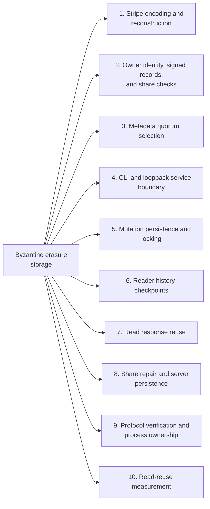

1. [Stripe encoding and reconstruction](#subsystem-stripe-encoding-and-reconstruction)
2. [Owner identity, signed records, and share checks](#subsystem-owner-identity-signed-records-and-share-checks)
3. [Metadata quorum selection](#subsystem-metadata-quorum-selection)
4. [CLI and loopback service boundary](#subsystem-cli-and-loopback-service-boundary)
5. [Mutation persistence and locking](#subsystem-mutation-persistence-and-locking)
6. [Reader history checkpoints](#subsystem-reader-history-checkpoints)
7. [Read response reuse](#subsystem-read-response-reuse)
8. [Share repair and server persistence](#subsystem-share-repair-and-server-persistence)
9. [Protocol verification and process ownership](#subsystem-protocol-verification-and-process-ownership)
10. [Read-reuse measurement](#subsystem-read-reuse-measurement)

Tahoe-LAFS remains the upstream application, codec and grid implementation. The separate BFR experiment in `bfr/` and `scripts/` adds a bounded four-server protocol using Tahoe's [erasure shares](#erasure-share). A trusted local client coordinates one honest owner per file, signs a [manifest](#signed-manifest) and validates reads. The four servers each store Tahoe share bytes and signed metadata.

</details>

<details>
<summary>Expand flow diagram 1</summary>

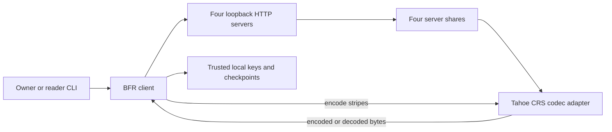

</details>

The experiment client coordinates loopback servers and local trust state. It calls Tahoe's erasure codec, while the preserved Tahoe grid application remains separate.

<details>
<summary>Expand flow diagram 2</summary>

```mermaid
flowchart TD
  subgraph Writer["Owner mutation"]
    N1["Input file"] --> N2["Split into bounded stripes"]
    N2["Split into bounded stripes"] --> N3["Tahoe encode n=4, k=2"]
    N3["Tahoe encode n=4, k=2"] --> N4["Sign version and share digests"]
    N4["Sign version and share digests"] --> Pending["Atomically persist exact pending operation"]
    Pending --> N5["Post metadata and share bytes"]
    N5 --> Ack{"Three distinct acknowledgments?"}
    Ack -->|"yes"| Committed["Resolve mutation and clear pending state"]
    Ack -->|"no"| N6["Fewer than three acknowledgments"]
    N6["Fewer than three acknowledgments"] --> N7["Retain already-persisted pending operation"]
    N7 --> N8["Saved pending operation"]
    N8["Saved pending operation"] --> N9["Retry exact update"]
    N9 --> N5
  end
  subgraph Reader["Quorum read"]
    N10["Query server metadata"] --> N11["Require three responses and two matching heads"]
    N11["Require three responses and two matching heads"] --> N12["Verify owner signature and checkpoint"]
    N12["Verify owner signature and checkpoint"] --> N13["Fetch two distinct matching shares"]
    N13["Fetch two distinct matching shares"] --> N14["Verify share digest and decode stripe"]
    N14 --> N15["Decoded stripes"]
    N15["Decoded stripes"] --> N16["Write output file"]
  end
  N17["Repair request"] --> N18["Reconstruct from two authenticated peer shares"]
  N18 --> N19["Reconstructed share"]
  N19["Reconstructed share"] --> N20["Check signed digest before storing"]
```

</details>

Writes persist the exact signed operation before sending it and retain that retry when acknowledgment is uncertain. Reads require a metadata quorum, check the pinned history and share digests, then decode from two distinct Tahoe shares. Repair checks reconstructed bytes against the owner's signed digest.

| Subsystem | Responsibility and owned state | Source |
| --- | --- | --- |
| CLI and process journey | Parses commands, configures client state and drives servers for verification. | [`scripts/bfr.py`](scripts/bfr.py), [`scripts/verify.py`](scripts/verify.py) |
| BFR client | Owns signing keys, pending writes, checkpoints, quorum logic and repair checks. | [`bfr/client.py`](bfr/client.py) |
| Signed protocol model | Defines version, manifest and share metadata validation. | [`bfr/model.py`](bfr/model.py) |
| Tahoe codec adapter | Encodes stripes as four shares and decodes from two distinct share IDs. | [`bfr/codec.py`](bfr/codec.py) |
| Server storage | Persists signed metadata and each server's assigned share bytes. | [`bfr/server.py`](bfr/server.py) |
| Client trust state | Stores owner keys, pending updates and reader checkpoints under per-file locks. | [`bfr/client.py`](bfr/client.py), [Repository architecture notes](AGENTS.md) |

Execution journey:

1. The owner creates local signing state and gives the client four distinct loopback server URLs.
2. Create or put splits the file into bounded stripes, asks Tahoe's CRS encoder for four shares per stripe, signs the version and share digests, and atomically saves the exact pending operation before posting the update.
3. Three distinct server acknowledgments resolve a write. If fewer answer, the client retains the exact signed operation and share bytes; `retry` resends that operation before another mutation starts.
4. A reader pins the owner's public key, requests metadata and requires a [quorum](#metadata-quorum) of three replies with two matching signed heads. It checks its [checkpoint](#checkpoint) to detect rollback behind its accepted version.
5. The reader fetches two distinct shares matching the signed manifest, verifies their digests, decodes with Tahoe's CRS decoder and writes the reconstructed output.
6. If a server missed updates, repair reconstructs its recent retained share from two authenticated peers and checks the owner's signed digest before storage. Missing quorum or failed checks stop the operation.

| Choice in the current implementation | Practical rationale | Alternative and cost to reconsider |
| --- | --- | --- |
| Keep the experiment outside Tahoe's grid APIs. | Preserves upstream code and limits protocol effects to its own CLI and loopback servers. | Integrating with the grid requires broader compatibility and security review. |
| Require three metadata acknowledgments and three metadata responses. | Separates signed-head agreement from the two shares needed for erasure decoding. | Lower thresholds can weaken the stated fault and rollback assumptions. |
| Use Tahoe's existing CRS encoder and decoder with `n=4`, `k=2`. | Reuses upstream codec behavior and reconstructs a stripe from two distinct shares. | A custom codec adds compatibility and correctness work. |
| Persist exact pending mutations and per-reader checkpoints. | Retries resend the same operation; checkpoints let readers detect a server rollback behind accepted history. | Stateless retry can create ambiguous duplicate operations; ephemeral checkpoints lose rollback memory. |
| Assume one honest owner writer and trusted client state. | Matches the implemented key and history model. | Multi-writer support or untrusted client storage requires a different consistency design and is not claimed here. |

These rationales are inferred from current code. The experiment does not provide full SUNDR fork consistency, Byzantine writer tolerance, confidentiality or production security.

<a id="erasure-share"></a>

<details><summary>What is an erasure share?</summary>

An erasure share is one encoded piece of data that can help reconstruct the original. This project uses Tahoe's `n=4`, `k=2` codec, so two distinct authenticated shares reconstruct one stripe.
</details>

<a id="signed-manifest"></a>

<details><summary>What is a signed manifest?</summary>

A signed manifest is owner-authenticated metadata describing a file version and its share digests. The reader verifies the signature and the downloaded share digest before decoding data.
</details>

<a id="metadata-quorum"></a>

<details><summary>What is a metadata quorum?</summary>

A metadata quorum is the required set of server responses used to choose a file head. Here a reader needs three responses and two matching signed heads, even though decoding needs only two shares.
</details>

<a id="checkpoint"></a>

<details><summary>What is a reader checkpoint?</summary>

A reader checkpoint is local saved state for the last accepted signed file version. It lets that reader notice when servers report a history rolled back behind its own checkpoint; it does not prove full fork consistency between all readers.
</details>

<a id="uncertain-write"></a>

<details><summary>What is an uncertain write?</summary>

An uncertain write is a signed mutation that did not receive enough acknowledgments to resolve. The client saves the exact operation and share bytes so `retry` can resend the same update.
</details>

<a id="repair"></a>

<details><summary>What is share repair?</summary>

Share repair rebuilds a server's missing recent share from authenticated peer shares. The client checks reconstructed bytes against the owner's signed digest before storing them.
</details>

## Implementation techniques

The cards describe the separate BFR client, CLI, servers, verification driver, and maintained benchmark paths. Tahoe's preserved grid APIs are outside this experiment; the adapter calls Tahoe's existing CRS codec. The reasons in these cards are inferred from the current code.

<details>
<summary>Full technique index</summary>

| Active subsystem | Technique cards | Source files |
| --- | --- | --- |
| Stripe encoding and reconstruction | [Tahoe CRS encoding in bounded stripes](#technique-erasure-signed-stripes) | [`bfr/codec.py`](bfr/codec.py), [`bfr/client.py`](bfr/client.py) |
| Owner identity, signed records, and share checks | [Owner-signed single-writer version chain](#technique-owner-signed-history), [signed share-manifest verification](#technique-signed-share-manifest), [bounded canonical record validation](#technique-bounded-record-validation) | [`bfr/model.py`](bfr/model.py), [`bfr/client.py`](bfr/client.py), [`bfr/server.py`](bfr/server.py) |
| Metadata quorum selection | [Metadata response and head quorum](#technique-metadata-quorum) | [`bfr/__init__.py`](bfr/__init__.py), [`bfr/client.py`](bfr/client.py) |
| CLI and loopback service boundary | [Loopback-only CLI and service boundary](#technique-loopback-cli-boundary) | [`scripts/bfr.py`](scripts/bfr.py), [`bfr/client.py`](bfr/client.py), [`bfr/server.py`](bfr/server.py) |
| Mutation persistence and locking | [Persist exact mutation before delivery](#technique-pending-before-send), [per-file mutation and checkpoint locks](#technique-per-file-locking) | [`bfr/client.py`](bfr/client.py), [`bfr/server.py`](bfr/server.py) |
| Reader history checkpoints | [Monotonic reader-history checkpoint](#technique-reader-checkpoint) | [`bfr/client.py`](bfr/client.py), [`bfr/model.py`](bfr/model.py) |
| Read response reuse | [Read-local full-response reuse with per-stripe checks](#technique-read-local-response-reuse) | [`bfr/client.py`](bfr/client.py), [`coursework/bfr_tests/test_protocol.py`](coursework/bfr_tests/test_protocol.py), [`scripts/verify_read_requests.py`](scripts/verify_read_requests.py) |
| Share repair and server persistence | [Authenticated repair with ordered atomic installation](#technique-authenticated-repair) | [`bfr/client.py`](bfr/client.py), [`bfr/server.py`](bfr/server.py), [`scripts/verify.py`](scripts/verify.py) |
| Protocol verification and process ownership | [Full-byte, signed-history, and adversarial oracles](#technique-byte-history-adversarial-oracles) | [`scripts/verify.py`](scripts/verify.py), [`coursework/bfr_tests/test_protocol.py`](coursework/bfr_tests/test_protocol.py), [`scripts/verify_read_requests.py`](scripts/verify_read_requests.py) |
| Read-reuse measurement | [Alternating complete-CLI comparison with byte gates](#technique-paired-cli-measurement), [scheduled-arrival benchmark with outcome gates](#technique-scheduled-load-outcome-gates) | [`scripts/compare_read_reuse.py`](scripts/compare_read_reuse.py), [`scripts/benchmark.py`](scripts/benchmark.py), [`coursework/bfr_tests/test_benchmark.py`](coursework/bfr_tests/test_benchmark.py), [`coursework/bfr_tests/test_read_comparison.py`](coursework/bfr_tests/test_read_comparison.py) |

</details>

<a id="subsystem-stripe-encoding-and-reconstruction"></a>

### 1. Stripe encoding and reconstruction

[Back to the subsystem map](#architecture-and-execution-guide).

**Code.** [`bfr/codec.py`](bfr/codec.py), [`bfr/client.py`](bfr/client.py), [`coursework/bfr_tests/test_protocol.py`](coursework/bfr_tests/test_protocol.py).

**Techniques.** [Tahoe CRS encoding in bounded stripes](#technique-erasure-signed-stripes).

**Related concepts.** [metadata quorum](#metadata-quorum).

<a id="technique-erasure-signed-stripes"></a>

<details>
<summary>Erasure stripes with signed share digests</summary>

**Mechanism.** The client splits input into bounded stripes, asks Tahoe's CRS codec for four shares, hashes each share and signs a descriptor that binds owner, file, version, stripe, share ID and digest. Reads verify each descriptor before decoding distinct shares. Stripes are at most 128 KiB; the decoder trims each result to its recorded length before joining them.

**Example.** For each stripe, two authenticated share IDs are passed to Tahoe's decoder.

**Why here.** Erasure coding tolerates server loss; signatures bind bytes to the selected version.

**Tradeoffs.** Readers need a metadata quorum. The experiment inherits Tahoe's codec and leaves grid APIs unchanged.

**Code and ownership.** [`bfr/client.py`](bfr/client.py#L339) `_encode_file` and [`bfr/client.py`](bfr/client.py#L293) `_manifest_share`; [`bfr/codec.py`](bfr/codec.py#L14) `encode_data` and `decode_data`. Mixed: extension and Tahoe codec dependency.


**Used in.** [Stripe encoding and reconstruction](#subsystem-stripe-encoding-and-reconstruction). [Back to the subsystem map](#architecture-and-execution-guide).

</details>

<a id="subsystem-owner-identity-signed-records-and-share-checks"></a>

### 2. Owner identity, signed records, and share checks

[Back to the subsystem map](#architecture-and-execution-guide).

**Code.** [`bfr/model.py`](bfr/model.py), [`bfr/client.py`](bfr/client.py).

**Techniques.** [Owner-signed single-writer version chain](#technique-owner-signed-history), [Signed share-manifest verification](#technique-signed-share-manifest), [Bounded canonical record validation](#technique-bounded-record-validation).

**Related concepts.** [metadata quorum](#metadata-quorum).

<a id="technique-owner-signed-history"></a>

<details>
<summary>Owner-signed single-writer version chain</summary>

**Mechanism.** The owner signs canonical JSON updates with Ed25519. Its ID is SHA-256 of its public key. Each version names the prior update hash as parent; `validate_history` checks signatures, owner, file, version, and parent links. An independent reader pins the key with `trust-owner`.

**Example.** Version 2 names the canonical hash of version 1 as its parent.

**Why here.** Readers can verify that a pinned owner signed each version in the chain.

**Tradeoffs.** The experiment assumes one honest writer and trusted client state. Private keys are unencrypted; signatures do not establish owner identity.

**Code and ownership.** [`bfr/model.py`](bfr/model.py#L76) `sign_update` and [`bfr/model.py`](bfr/model.py#L156) `validate_history` implement the chain. [`bfr/client.py`](bfr/client.py#L64) `initialize` and `_owner_public` manage keys. Mixed: extension and Ed25519 dependency.


**Used in.** [Owner identity, signed records, and share checks](#subsystem-owner-identity-signed-records-and-share-checks). [Back to the subsystem map](#architecture-and-execution-guide).

</details>

<a id="technique-signed-share-manifest"></a>

<details>
<summary>Signed share-manifest verification</summary>

**Mechanism.** Each update signs every share digest, bound to owner, file, version, stripe, and share ID. The reader checks the selected update and share ID, hashes the bytes, then verifies that descriptor's signature before decoding.

**Example.** A replayed share record for an older signed update fails the version comparison before the client decodes it.

**Why here.** A metadata quorum selects a history, while the signed stripe descriptors bind the fetched bytes to that history.

**Tradeoffs.** These checks prove integrity against a pinned key. They do not encrypt shares or establish owner enrollment.

**Code and ownership.** [`bfr/model.py`](bfr/model.py#L84) `block_message` and [`bfr/model.py`](bfr/model.py#L95) `validate_update` validate descriptors. [`bfr/client.py`](bfr/client.py#L293) `_manifest_share` and [`bfr/client.py`](bfr/client.py#L305) `validate_share_response` check shares. Mixed: extension and Ed25519 dependency.


**Used in.** [Owner identity, signed records, and share checks](#subsystem-owner-identity-signed-records-and-share-checks). [Back to the subsystem map](#architecture-and-execution-guide).

</details>

<a id="technique-bounded-record-validation"></a>

<details>
<summary>Bounded canonical record validation</summary>

**Mechanism.** The model signs sorted, compact JSON. It rejects malformed base64 and caps fields, file IDs, versions, file sizes, stripe counts, and histories. The server caps request and stored-record reads. The client rejects replies larger than its response limit.

**Example.** `validate_update` rejects a put above 1 MiB or with stripe lengths that do not sum to the declared file size.

**Why here.** The server applies bounds before persistence; the client validates records before accepting history.

**Tradeoffs.** The fixed limits rule out larger files and histories. They bound individual protocol records, not total disk use.

**Code and ownership.** [`bfr/model.py`](bfr/model.py#L25) `canonical`, [`bfr/model.py`](bfr/model.py#L33) `unb64`, and [`bfr/model.py`](bfr/model.py#L95) `validate_update` define checks. [`bfr/server.py`](bfr/server.py#L131) `Handler._parse_body` caps requests. Extension.


**Used in.** [Owner identity, signed records, and share checks](#subsystem-owner-identity-signed-records-and-share-checks). [Back to the subsystem map](#architecture-and-execution-guide).

</details>

<a id="subsystem-metadata-quorum-selection"></a>

### 3. Metadata quorum selection

[Back to the subsystem map](#architecture-and-execution-guide).

**Code.** [`bfr/__init__.py`](bfr/__init__.py), [`bfr/client.py`](bfr/client.py), [`coursework/bfr_tests/test_protocol.py`](coursework/bfr_tests/test_protocol.py).

**Techniques.** [Metadata response and head quorum](#technique-metadata-quorum).

**Related concepts.** [metadata quorum](#metadata-quorum).

<a id="technique-metadata-quorum"></a>

<details>
<summary>Exact-head metadata quorum</summary>

**Mechanism.** The reader verifies histories and chooses the freshest witnessed head. It requires three metadata responses and two matching signed heads, though decoding needs two shares. It selects the highest qualified version and rejects distinct heads tied at that version.

**Example.** Two version-3 votes beat two stale version-2 replies. Two total replies fail the response threshold.

**Why here.** Metadata selection and data reconstruction have separate thresholds.

**Tradeoffs.** Reads fail below three responses, even if two shares remain. This is not full SUNDR fork consistency or Byzantine writer tolerance.

**Code and ownership.** [`bfr/client.py`](bfr/client.py#L192) `_history_votes` selects a head. Extension. [`bfr/__init__.py`](bfr/__init__.py#L8) and [`bfr/__init__.py`](bfr/__init__.py#L9) set response and vote thresholds.


**Used in.** [Metadata quorum selection](#subsystem-metadata-quorum-selection). [Back to the subsystem map](#architecture-and-execution-guide).

</details>

<a id="subsystem-cli-and-loopback-service-boundary"></a>

### 4. CLI and loopback service boundary

[Back to the subsystem map](#architecture-and-execution-guide).

**Code.** [`scripts/bfr.py`](scripts/bfr.py), [`bfr/client.py`](bfr/client.py), [`bfr/server.py`](bfr/server.py).

**Techniques.** [Loopback-only CLI and service boundary](#technique-loopback-cli-boundary).

**Related concepts.** [uncertain write](#uncertain-write).

<a id="technique-loopback-cli-boundary"></a>

<details>
<summary>Loopback-only CLI and service boundary</summary>

**Mechanism.** The CLI exposes named commands and restricts targets and share IDs to four values. Client URLs require four distinct ports, plain HTTP, and loopback IPs. The client normalizes them to `127.0.0.1`; the server rejects non-loopback binds. CLI errors distinguish uncertain writes from other failures.

**Example.** A client URL with a hostname, path, query, fragment, or repeated port is rejected before an RPC.

**Why here.** The protocol experiment uses local disk-backed servers and trusted client state.

**Tradeoffs.** The service cannot accept remote clients. Plain HTTP and unencrypted keys provide no confidentiality.

**Code and ownership.** [`scripts/bfr.py`](scripts/bfr.py#L25) `parser` and [`scripts/bfr.py`](scripts/bfr.py#L68) `main` route commands. [`bfr/client.py`](bfr/client.py#L115) `_urls` and [`bfr/server.py`](bfr/server.py#L236) `serve` restrict addresses. Extension.


**Used in.** [CLI and loopback service boundary](#subsystem-cli-and-loopback-service-boundary). [Back to the subsystem map](#architecture-and-execution-guide).

</details>

<a id="subsystem-mutation-persistence-and-locking"></a>

### 5. Mutation persistence and locking

[Back to the subsystem map](#architecture-and-execution-guide).

**Code.** [`bfr/__init__.py`](bfr/__init__.py), [`bfr/client.py`](bfr/client.py), [`bfr/server.py`](bfr/server.py), [`coursework/bfr_tests/test_protocol.py`](coursework/bfr_tests/test_protocol.py).

**Techniques.** [Persist exact mutation before delivery](#technique-pending-before-send), [Per-file mutation and checkpoint locks](#technique-per-file-locking).

<a id="technique-pending-before-send"></a>

<details>
<summary>Persist pending mutation before sending</summary>

**Mechanism.** The client atomically saves the exact signed update, history and encoded share bytes before network delivery. If acknowledgments are insufficient, it retains the pending record so retry resends identical bytes. Per-file OS locks serialize mutation state. Three distinct acknowledgments resolve a write.

**Example.** A timeout after some servers accept a write leaves a retryable operation on disk.

**Why here.** A client crash or uncertain response must not cause a different operation to reuse the same parent version.

**Tradeoffs.** The local state is required for safe retry and must be protected. An uncertain result is not a committed write.

**Code and ownership.** [`bfr/client.py`](bfr/client.py#L154) locking and [`bfr/client.py`](bfr/client.py#L377) `_deliver`. Extension. [`bfr/client.py`](bfr/client.py#L403) `_put_locked` saves before sending; [`bfr/client.py`](bfr/client.py#L450) `_retry_locked` reloads.


**Used in.** [Mutation persistence and locking](#subsystem-mutation-persistence-and-locking). [Back to the subsystem map](#architecture-and-execution-guide).

</details>

<a id="technique-per-file-locking"></a>

<details>
<summary>Per-file mutation and checkpoint locks</summary>

**Mechanism.** Mutations and checkpoints use separate OS locks keyed by owner and file. The client uses `msvcrt.locking` on Windows and `fcntl.flock` on POSIX. Each server uses an in-process per-file `threading.Lock` during installation.

**Example.** Older and newer checkpoint writes serialize across client processes; the newer chain remains saved.

**Why here.** Local CLI processes share state, and each server handles threaded HTTP requests.

**Tradeoffs.** Locks serialize one file and require local filesystem lock support. They do not coordinate separate state directories.

**Code and ownership.** [`bfr/client.py`](bfr/client.py#L154) `_os_file_lock`, `_mutation_lock`, `_checkpoint_lock`; [`bfr/server.py`](bfr/server.py#L143) `Handler._install`. Extension.


**Used in.** [Mutation persistence and locking](#subsystem-mutation-persistence-and-locking). [Back to the subsystem map](#architecture-and-execution-guide).

</details>

<a id="subsystem-reader-history-checkpoints"></a>

### 6. Reader history checkpoints

[Back to the subsystem map](#architecture-and-execution-guide).

**Code.** [`bfr/client.py`](bfr/client.py), [`bfr/model.py`](bfr/model.py), [`coursework/bfr_tests/test_protocol.py`](coursework/bfr_tests/test_protocol.py).

**Techniques.** [Monotonic reader-history checkpoint](#technique-reader-checkpoint).

<a id="technique-reader-checkpoint"></a>

<details>
<summary>Per-reader signed-history checkpoint</summary>

**Mechanism.** A reader validates signed history against its saved checkpoint, then atomically advances it under a per-file lock. A history that does not extend the saved chain is rejected. Export and audit compare checkpoints and report same, extension, or divergence.

**Example.** After accepting version 4, a reader rejects version 3 or an empty history.

**Why here.** Local state detects rollback behind one reader's prior observation.

**Tradeoffs.** New readers or lost state have no earlier witness. Checkpoints are not full SUNDR fork consistency.

**Code and ownership.** [`bfr/client.py`](bfr/client.py#L253) `_history_checkpoint`; [`bfr/model.py`](bfr/model.py#L172) `checkpoint_relation`, [`bfr/client.py`](bfr/client.py#L578) `export_checkpoint`. Extension.


**Used in.** [Reader history checkpoints](#subsystem-reader-history-checkpoints). [Back to the subsystem map](#architecture-and-execution-guide).

</details>

<a id="subsystem-read-response-reuse"></a>

### 7. Read response reuse

[Back to the subsystem map](#architecture-and-execution-guide).

**Code.** [`bfr/client.py`](bfr/client.py), [`coursework/bfr_tests/test_protocol.py`](coursework/bfr_tests/test_protocol.py), [`scripts/verify_read_requests.py`](scripts/verify_read_requests.py).

**Techniques.** [Read-local full-response reuse with per-stripe checks](#technique-read-local-response-reuse).

<a id="technique-read-local-response-reuse"></a>

<details>
<summary>Read-local full-response reuse with per-stripe checks</summary>

**Mechanism.** One read keeps successful full block responses in a local map. `_collect_shares` checks update, share ID, stripe count, digest, and signature for each stripe. It removes a response before checking it; if a check fails, a later stripe fetches it again. Each stripe still needs two distinct valid shares.

**Example.** A multi-stripe read can fetch one full response per server and check each stripe from that response.

**Why here.** Each server reply contains all stripes for that version.

**Tradeoffs.** Reuse lasts one read. A response that fails one stripe is fetched again, and each stripe still needs verification.

**Code and ownership.** [`bfr/client.py`](bfr/client.py#L314) `_collect_shares` and [`bfr/client.py`](bfr/client.py#L486) `read` implement reuse. [`coursework/bfr_tests/test_protocol.py`](coursework/bfr_tests/test_protocol.py#L47) checks stripe validation. Extension.


**Used in.** [Read response reuse](#subsystem-read-response-reuse). [Back to the subsystem map](#architecture-and-execution-guide).

</details>

<a id="subsystem-share-repair-and-server-persistence"></a>

### 8. Share repair and server persistence

[Back to the subsystem map](#architecture-and-execution-guide).

**Code.** [`bfr/client.py`](bfr/client.py), [`bfr/server.py`](bfr/server.py), [`scripts/verify.py`](scripts/verify.py).

**Techniques.** [Authenticated repair with ordered atomic installation](#technique-authenticated-repair).

<a id="technique-authenticated-repair"></a>

<details>
<summary>Repair from authenticated peer shares</summary>

**Mechanism.** The repair client gathers verified peer shares, decodes and re-encodes with Tahoe's codec, and checks the target digest. It repairs the selected head before older retained versions. The server validates and atomically replaces share and metadata records while preserving newer history.

**Example.** A returned server receives a recent share reconstructed from two healthy peers.

**Why here.** Repair restores a missing replica without changing the signed file version.

**Tradeoffs.** Repair needs two valid peers per stripe and the original signed descriptor. The server retains eight versions of share bytes.

**Code and ownership.** [`bfr/client.py`](bfr/client.py#L533) `_repair_payloads`, `repair`; [`bfr/server.py`](bfr/server.py#L143) `_install`, `_install_unlocked`. Mixed: extension and Tahoe codec dependency.


**Used in.** [Share repair and server persistence](#subsystem-share-repair-and-server-persistence). [Back to the subsystem map](#architecture-and-execution-guide).

</details>

<a id="subsystem-protocol-verification-and-process-ownership"></a>

### 9. Protocol verification and process ownership

[Back to the subsystem map](#architecture-and-execution-guide).

**Code.** [`scripts/verify.py`](scripts/verify.py), [`coursework/bfr_tests/test_protocol.py`](coursework/bfr_tests/test_protocol.py), [`scripts/verify_read_requests.py`](scripts/verify_read_requests.py).

**Techniques.** [Full-byte, signed-history, and adversarial oracles](#technique-byte-history-adversarial-oracles).

<a id="technique-byte-history-adversarial-oracles"></a>

<details>
<summary>Full-byte, signed-history, and adversarial oracles</summary>

**Mechanism.** Tests compare reconstructed bytes, versions, requests, and checkpoints. The process driver uses four owned loopback servers and real CLI calls to exercise rollback, old-share replay, missing quorum, retry after restart, repair, deletion, and recreation. Unit cases tamper with signatures, keys, share IDs, and checkpoint order.

**Example.** The read proof compares all 1 MiB of output and checks four metadata plus four block requests through real HTTP and codec calls.

**Why here.** These checks cover outputs and rejection paths through functions and independent processes.

**Tradeoffs.** Finite adversarial inputs do not prove safety against every malicious-server strategy.

**Code and ownership.** [`scripts/verify.py`](scripts/verify.py#L192) `Run.drive`, [`coursework/bfr_tests/test_protocol.py`](coursework/bfr_tests/test_protocol.py#L297), and [`scripts/verify_read_requests.py`](scripts/verify_read_requests.py#L17) contain the oracles. Extension.


**Used in.** [Protocol verification and process ownership](#subsystem-protocol-verification-and-process-ownership). [Back to the subsystem map](#architecture-and-execution-guide).

</details>

<a id="subsystem-read-reuse-measurement"></a>

### 10. Read-reuse measurement

[Back to the subsystem map](#architecture-and-execution-guide).

**Code.** [`scripts/compare_read_reuse.py`](scripts/compare_read_reuse.py), [`scripts/benchmark.py`](scripts/benchmark.py), [`coursework/bfr_tests/test_benchmark.py`](coursework/bfr_tests/test_benchmark.py), [`coursework/bfr_tests/test_read_comparison.py`](coursework/bfr_tests/test_read_comparison.py).

**Techniques.** [Alternating complete-CLI comparison with byte gates](#technique-paired-cli-measurement), [Scheduled-arrival benchmark with outcome gates](#technique-scheduled-load-outcome-gates).

**Related concepts.** [reader checkpoint](#checkpoint).

<a id="technique-paired-cli-measurement"></a>

<details>
<summary>Alternating complete-CLI comparison with byte gates</summary>

**Mechanism.** The comparison uses one baseline and one candidate against the same servers, file, and reader checkpoint. It warms both, alternates order across five pairs, times each full CLI command with Hyperfine, and compares output bytes with input. It also checks that shared protocol, server, CLI, and dependency files match.

**Example.** A 1 MiB run enters the summary only after returning the exact input bytes.

**Why here.** The comparison measures read-local response reuse through the full CLI, including startup and output fsync.

**Tradeoffs.** Results describe one loopback host and tested sizes. They do not establish WAN behavior or throughput.

**Code and ownership.** [`scripts/compare_read_reuse.py`](scripts/compare_read_reuse.py#L39) `run_hyperfine` and [`scripts/compare_read_reuse.py`](scripts/compare_read_reuse.py#L76) `main` define the comparison. [`coursework/bfr_tests/test_read_comparison.py`](coursework/bfr_tests/test_read_comparison.py#L11) checks its Hyperfine contract. Mixed: extension and Hyperfine dependency.


**Used in.** [Read-reuse measurement](#subsystem-read-reuse-measurement). [Back to the subsystem map](#architecture-and-execution-guide).

</details>

<a id="technique-scheduled-load-outcome-gates"></a>

<details>
<summary>Scheduled-arrival benchmark with outcome gates</summary>

**Mechanism.** The benchmark schedules CLI reads at a fixed rate through a thread pool. It hashes each output and counts correct completions, expected two-server quorum rejections, other errors, and timeouts separately. It compares BFR with local disk using Tahoe's codec, without HTTP, signatures, or quorum.

**Example.** Two stopped servers count as an expected rejection only when the CLI reports that exact quorum error and creates no output.

**Why here.** Scheduled arrivals expose queue delay that a closed-loop single reader does not show.

**Tradeoffs.** Finite batches do not establish service capacity. The trusted codec side is not an equivalent security system.

**Code and ownership.** [`scripts/benchmark.py`](scripts/benchmark.py#L37) `load_outcomes`, `expected_quorum_rejection`, `benchmark`; [`coursework/bfr_tests/test_benchmark.py`](coursework/bfr_tests/test_benchmark.py#L25) checks classification. Extension.


**Used in.** [Read-reuse measurement](#subsystem-read-reuse-measurement). [Back to the subsystem map](#architecture-and-execution-guide).

</details>

## Guide

[Implementation techniques](#implementation-techniques) ·
[Architecture and execution guide](#architecture-and-execution-guide) · [Run it](#run-it) · [Verify](#verify) · [Protocol and limits](#protocol-and-limits) · [Coursework and research](#coursework-and-research)

## Run it

Use Python 3.11 and install the hash-locked requirements in an isolated environment:

```sh
python -m pip install --require-hashes -r requirements.lock
```

Start four separate servers in four terminals, replacing each storage path with a directory you control:

```sh
python scripts/bfr.py server --root ./data/server-0 --port 17800 --share-id 0
python scripts/bfr.py server --root ./data/server-1 --port 17801 --share-id 1
python scripts/bfr.py server --root ./data/server-2 --port 17802 --share-id 2
python scripts/bfr.py server --root ./data/server-3 --port 17803 --share-id 3
```

Create an owner key, create a file, and read it back:

```sh
python scripts/bfr.py --state ./data/owner keygen
python scripts/bfr.py --state ./data/owner create sample ./input.bin
python scripts/bfr.py --state ./data/owner read sample ./output.bin
python scripts/bfr.py --state ./data/owner list
python scripts/bfr.py --state ./data/owner put sample ./replacement.bin
python scripts/bfr.py --state ./data/owner delete sample
```

If a write reports an `uncertain` outcome, keep the client state and run `retry` for that file. It resends the exact signed update and share bytes saved before the first send. Do not start another mutation for that file until the retry resolves.

An independent reader uses its own state directory and pins the owner's `owner.pub` file with `trust-owner`. A reader checkpoint detects a server history rolled back behind the last accepted signed version. `export-checkpoint` and `audit-checkpoints` compare two readers' signed histories.

To repair a server that missed recent updates, run `repair FILE --target N --owner OWNER_ID` after it is back online. Repair reconstructs its recent retained shares from two authenticated peer shares and checks the result against the original owner's signed digest before storing it.

## Verify

Run the complete native process journey with:

```sh
python scripts/verify.py all --run-id local-check
```

It starts four loopback-only servers with temporary disk roots, runs the CLI as an owner and independent reader, exercises quorum faults and restarts, then stops only those recorded processes. JSON evidence and server transcripts remain under `.agents/runs/local-check/evidence/` after scratch data is removed. The project-local [verification skill](.agents/skills/verify-bfr/SKILL.md) documents the individual Launch, Doctor, Drive, Evidence, and Cleanup phases.

The pinned GitHub workflow repeats the Tahoe CLI and codec checks, deterministic protocol checks, and the same process journey on Ubuntu. Its artifact contains the server logs and evidence for each run.

The native Windows journey and its post-launch failure control have passed locally. Both retained terminal verdicts and successful cleanup of their four owned processes. The [native Ubuntu run](https://github.com/STEVVVU/byzantine-erasure-storage/actions/runs/39720831869) also passed the Tahoe version command, three upstream codec tests, eleven protocol tests, the four-process journey, and its failure control. [Retained JSON evidence](docs/evidence/linux-39720831869/) records the successful and deliberately failed verdicts after cleanup.

## Coursework and research

The [hosted metrics run](https://github.com/STEVVVU/byzantine-erasure-storage/actions/runs/39732079698) measured four real disk-backed processes at source `d7daaec`, on a four-vCPU Ubuntu runner with Python 3.11.17 and the hash-locked runtime. Five alternating repeats compared authenticated BFR reads with trusted local-disk reads using the same Tahoe n4/k2 codec. Both start a fresh CLI and fsync reconstructed output. The trusted baseline omits HTTP, signatures and quorum, so it is an overhead floor, not an equivalent security system. Healthy useful throughput is in MiB/s, median [range] over five batches:

| File size | BFR concurrency 1 | BFR concurrency 4 | BFR concurrency 8 | Trusted codec concurrency 4 |
|---|---:|---:|---:|---:|
| 4 KiB | 0.0124 [0.0123–0.0125] | 0.0314 [0.0312–0.0317] | 0.0292 [0.0290–0.0301] | 0.0322 [0.0317–0.0333] |
| 128 KiB | 0.376 [0.361–0.382] | 0.950 [0.920–0.961] | 0.897 [0.869–0.900] | 0.994 [0.969–0.998] |
| 1 MiB | 1.900 [1.860–1.944] | 4.478 [4.398–4.572] | 4.465 [4.424–4.536] | 8.118 [7.797–8.351] |

All **180 batches** satisfy **31,200 offered = 23,400 exact completions + 7,800 expected rejections**, with zero unrelated errors/timeouts. Healthy and one-stopped-server reads reconstructed exact source bytes. With two servers stopped, every read exited 2 with `metadata needs 3 server responses; received 2` and created no output. The metadata quorum is preserved even though erasure decoding needs two shares. These load faults stop servers; they do not measure actively malicious responders under load.

Scheduled rates were 4/16/32 requests/s at worker concurrency 1/4/8, with client queue delay included. At 1 MiB and concurrency 4, healthy p95 ranged 23.9–25.2 s and empirical p99 25.1–26.5 s; at concurrency 8 they rose to 58.2–60.0 s and 60.5–62.2 s without useful-throughput growth. These are finite overloaded batches, not sustainable 32/s service capacity. Each concurrency-1 batch has only 40 observations, so its p99 is omitted. A separate 60.2-second closed-loop 4 KiB stability check completed 182 correct reads.

Five 1 MiB repairs each reconstructed the original signed version: repair median 0.529 s [0.518–0.549], restart readiness 0.305 s [0.305–0.306]. These are absolute timings with no matched trusted/no-fault repair-time baseline. Storage snapshots were 4.98×/3.09×/2.76× aggregate server bytes over cumulative logical bytes at the three sizes; they include earlier sample/repair files and precede each size's repair sweep, so they are not final campaign footprint or per-file-only amplification. Maximum measured child RSS was 57,720 KiB; maximum server RSS snapshots were about 61–64 MB each.

The [expanded baseline campaign](https://github.com/STEVVVU/byzantine-erasure-storage/actions/runs/39747376867) completed all three size-qualified profiles and 60-second closed-loop checks at source `e1ce5826e`. Its separate 1 MiB profile showed 36 HTTP requests, about 0.191 s cumulative inside a 0.239 s read. The client fetched each server's complete share record again for each of eight stripes. CLI imports also took about 0.321 s of the 0.568 s instrumented command. Nested cumulative times must not be added. Baseline full-load medians and stability results are retained in the [expanded receipt](docs/evidence/read-response-reuse-20261022/measurement.json); different hosted runs do not establish a causal speedup.

The reader now reuses successful full responses within one read while verifying each stripe's signed version, share identity, digest and signature. A real four-server 1 MiB reconstruction required **8 HTTP requests instead of the baseline's 36**, with exact output bytes. Sixteen protocol/benchmark tests and the maintained normal/fault journey passed locally. `python scripts/verify_read_requests.py --run-id <fresh-id>` reproduces the request-count proof with real HTTP and the Tahoe codec. Response reuse does not guarantee immediate visibility of a repair to previously corrupt cached bytes during that same read; a rejected response is evicted for later stripes, and every new read fetches afresh. A matched timing comparison is still required before claiming a throughput gain.

[Earlier all-cell counts/tails, repairs, resources and artifact hashes](docs/evidence/metrics-39732079698/measurement.json) remain unchanged. Reproduce the full workload with `python scripts/benchmark.py --run-id <fresh-id>` or the manual [metrics workflow](.github/workflows/metrics.yml). The [measurement contract](.agents/skills/verify-bfr/features/metrics.md) retains the security and baseline boundaries.

The bounded protocol follows the quorum and erasure-storage ideas in the [Stanford CS244b Byzantine RAID project](https://www.scs.stanford.edu/24sp-cs244b/projects/Byzantine_Fault-tolerant_RAID-like_Filesystem.pdf). Persistent reader checkpoints and explicit history comparison adapt part of [SUNDR's signed-history approach](https://www.usenix.org/legacy/events/osdi04/tech/full_papers/li_j/li_j.pdf). These mechanisms are separate from Tahoe's native grid protocol and do not establish the full guarantees of either paper.

## Protocol and limits

- A mutation is a full-file version up to 1 MiB. Each file can have at most 256 signed metadata versions; servers retain share bytes for the latest eight versions.
- Writers are single-owner and use one trusted client state at a time. A saved local signed history allows that owner to form an update when fewer than three metadata servers answer; the write remains explicitly uncertain until three servers acknowledge the identical operation.
- Readers need a metadata quorum before selecting a version. They then accept only two distinct shares matching that version's owner-signed manifest. Repair re-encodes the same deterministic Tahoe shares and retains the original signatures.
- The checkpoint exchange is a small SUNDR-inspired history witness. It detects rollback for a reader that still has trusted state and can report divergent exported histories. It is not full SUNDR fork consistency or multi-writer linearizability.
- The experiment uses plain HTTP bound to literal loopback addresses. Server files and owner private keys are stored unencrypted. It does not provide confidentiality, authenticated owner enrollment, a production security audit, a FUSE mount, or changes to Tahoe's native grid interfaces.

Tahoe-LAFS is provided under its existing GPL-2.0-or-later or TGPPL-1.0 licensing terms; consult [COPYING.GPL](COPYING.GPL), [COPYING.TGPPL.rst](COPYING.TGPPL.rst), and the notices in the upstream files before redistribution.
