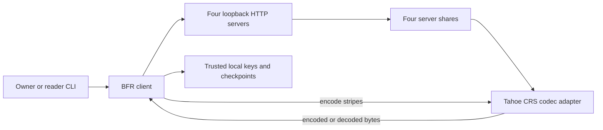

# Byzantine erasure storage

The [matched Hyperfine comparison](docs/read-reuse-benchmark.md) measured a warm 1 MiB complete-CLI read at **336 ms median versus 485 ms baseline (30.7% lower)** across five alternating pairs on one four-server loopback host. All 30 timed outputs matched exactly. Small-file timings showed no clear gain, and 1 MiB median peak RSS increased 4.1%. This measures one reader including startup and fsync; it does not establish loaded throughput, p99 or WAN performance.

This repository preserves the full Tahoe-LAFS source tree and Git history at upstream revision [`f002fd0d27d9a3da5c0da162b10725838353bd63`](https://github.com/tahoe-lafs/tahoe-lafs/tree/f002fd0d27d9a3da5c0da162b10725838353bd63). The original [Tahoe README](README.rst), source files, and both upstream license texts remain in place. The coursework code is a separate, bounded protocol experiment under [`bfr/`](bfr/) that imports Tahoe's `CRSEncoder` and `CRSDecoder`; it does not claim to modify Tahoe's grid protocol.

The experiment stores one signed file history across four disk-backed loopback servers. With `n=4`, `b=1`, and `f=2`, it uses two Tahoe erasure shares to reconstruct a stripe, requires three distinct acknowledgments for a mutation, and requires three metadata responses with two matching signed heads. Each owner signs its version history and each stripe's four share digests. The reader verifies those signatures and pins the accepted history in its own persistent state.

## Guide

[Architecture and execution guide](#architecture-and-execution-guide) · [Run it](#run-it) · [Verify](#verify) · [Protocol and limits](#protocol-and-limits) · [Coursework and research](#coursework-and-research)

## Architecture and execution guide

Tahoe-LAFS remains the upstream application, codec and grid implementation. The separate BFR experiment in `bfr/` and `scripts/` adds a bounded four-server protocol using Tahoe's [erasure shares](#erasure-share). A trusted local client coordinates one honest owner per file, signs a [manifest](#signed-manifest) and validates reads. The four servers each store Tahoe share bytes and signed metadata.



The experiment client coordinates loopback servers and local trust state. It calls Tahoe's erasure codec, while the preserved Tahoe grid application remains separate.

```mermaid
flowchart TD
  subgraph Writer["Owner mutation"]
    N1["Input file"] --> N2["Split into bounded stripes"]
    N2["Split into bounded stripes"] --> N3["Tahoe encode n=4, k=2"]
    N3["Tahoe encode n=4, k=2"] --> N4["Sign version and share digests"]
    N4["Sign version and share digests"] --> Pending["Atomically persist exact pending operation"]
    Pending --> N5["Post metadata and share bytes"]
    N5 --> Ack{"Three distinct acknowledgments?"}
    Ack -->|"yes"| Committed["Resolve mutation and clear pending state"]
    Ack -->|"no"| N6["Fewer than three acknowledgments"]
    N6["Fewer than three acknowledgments"] --> N7["Retain already-persisted pending operation"]
    N7 --> N8["Saved pending operation"]
    N8["Saved pending operation"] --> N9["Retry exact update"]
    N9 --> N5
  end
  subgraph Reader["Quorum read"]
    N10["Query server metadata"] --> N11["Require three responses and two matching heads"]
    N11["Require three responses and two matching heads"] --> N12["Verify owner signature and checkpoint"]
    N12["Verify owner signature and checkpoint"] --> N13["Fetch two distinct matching shares"]
    N13["Fetch two distinct matching shares"] --> N14["Verify share digest and decode stripe"]
    N14 --> N15["Decoded stripes"]
    N15["Decoded stripes"] --> N16["Write output file"]
  end
  N17["Repair request"] --> N18["Reconstruct from two authenticated peer shares"]
  N18 --> N19["Reconstructed share"]
  N19["Reconstructed share"] --> N20["Check signed digest before storing"]
```



Writes persist the exact signed operation before sending it and retain that retry when acknowledgment is uncertain. Reads require a metadata quorum, check the pinned history and share digests, then decode from two distinct Tahoe shares. Repair checks reconstructed bytes against the owner's signed digest.

| Subsystem | Responsibility and owned state | Source |
| --- | --- | --- |
| CLI and process journey | Parses commands, configures client state and drives servers for verification. | [`scripts/bfr.py`](scripts/bfr.py), [`scripts/verify.py`](scripts/verify.py) |
| BFR client | Owns signing keys, pending writes, checkpoints, quorum logic and repair checks. | [`bfr/client.py`](bfr/client.py) |
| Signed protocol model | Defines version, manifest and share metadata validation. | [`bfr/model.py`](bfr/model.py) |
| Tahoe codec adapter | Encodes stripes as four shares and decodes from two distinct share IDs. | [`bfr/codec.py`](bfr/codec.py) |
| Server storage | Persists signed metadata and each server's assigned share bytes. | [`bfr/server.py`](bfr/server.py) |
| Client trust state | Stores owner keys, pending updates and reader checkpoints under per-file locks. | [`bfr/client.py`](bfr/client.py), [Repository architecture notes](AGENTS.md) |

Execution journey:

1. The owner creates local signing state and gives the client four distinct loopback server URLs.
2. Create or put splits the file into bounded stripes, asks Tahoe's CRS encoder for four shares per stripe, signs the version and share digests, and atomically saves the exact pending operation before posting the update.
3. Three distinct server acknowledgments resolve a write. If fewer answer, the client retains the exact signed operation and share bytes; `retry` resends that operation before another mutation starts.
4. A reader pins the owner's public key, requests metadata and requires a [quorum](#metadata-quorum) of three replies with two matching signed heads. It checks its [checkpoint](#checkpoint) to detect rollback behind its accepted version.
5. The reader fetches two distinct shares matching the signed manifest, verifies their digests, decodes with Tahoe's CRS decoder and writes the reconstructed output.
6. If a server missed updates, repair reconstructs its recent retained share from two authenticated peers and checks the owner's signed digest before storage. Missing quorum or failed checks stop the operation.

| Choice in the current implementation | Practical rationale | Alternative and cost to reconsider |
| --- | --- | --- |
| Keep the experiment outside Tahoe's grid APIs. | Preserves upstream code and limits protocol effects to its own CLI and loopback servers. | Integrating with the grid requires broader compatibility and security review. |
| Require three metadata acknowledgments and three metadata responses. | Separates signed-head agreement from the two shares needed for erasure decoding. | Lower thresholds can weaken the stated fault and rollback assumptions. |
| Use Tahoe's existing CRS encoder and decoder with `n=4`, `k=2`. | Reuses upstream codec behavior and reconstructs a stripe from two distinct shares. | A custom codec adds compatibility and correctness work. |
| Persist exact pending mutations and per-reader checkpoints. | Retries resend the same operation; checkpoints let readers detect a server rollback behind accepted history. | Stateless retry can create ambiguous duplicate operations; ephemeral checkpoints lose rollback memory. |
| Assume one honest owner writer and trusted client state. | Matches the implemented key and history model. | Multi-writer support or untrusted client storage requires a different consistency design and is not claimed here. |

These rationales are inferred from current code. The experiment does not provide full SUNDR fork consistency, Byzantine writer tolerance, confidentiality or production security.

<a id="erasure-share"></a>

<details><summary>What is an erasure share?</summary>

An erasure share is one encoded piece of data that can help reconstruct the original. This project uses Tahoe's `n=4`, `k=2` codec, so two distinct authenticated shares reconstruct one stripe.
</details>

<a id="signed-manifest"></a>

<details><summary>What is a signed manifest?</summary>

A signed manifest is owner-authenticated metadata describing a file version and its share digests. The reader verifies the signature and the downloaded share digest before decoding data.
</details>

<a id="metadata-quorum"></a>

<details><summary>What is a metadata quorum?</summary>

A metadata quorum is the required set of server responses used to choose a file head. Here a reader needs three responses and two matching signed heads, even though decoding needs only two shares.
</details>

<a id="checkpoint"></a>

<details><summary>What is a reader checkpoint?</summary>

A reader checkpoint is local saved state for the last accepted signed file version. It lets that reader notice when servers report a history rolled back behind its own checkpoint; it does not prove full fork consistency between all readers.
</details>

<a id="uncertain-write"></a>

<details><summary>What is an uncertain write?</summary>

An uncertain write is a signed mutation that did not receive enough acknowledgments to resolve. The client saves the exact operation and share bytes so `retry` can resend the same update.
</details>

<a id="repair"></a>

<details><summary>What is share repair?</summary>

Share repair rebuilds a server's missing recent share from authenticated peer shares. The client checks reconstructed bytes against the owner's signed digest before storing them.
</details>

## Run it

Use Python 3.11 and install the hash-locked requirements in an isolated environment:

```sh
python -m pip install --require-hashes -r requirements.lock
```

Start four separate servers in four terminals, replacing each storage path with a directory you control:

```sh
python scripts/bfr.py server --root ./data/server-0 --port 17800 --share-id 0
python scripts/bfr.py server --root ./data/server-1 --port 17801 --share-id 1
python scripts/bfr.py server --root ./data/server-2 --port 17802 --share-id 2
python scripts/bfr.py server --root ./data/server-3 --port 17803 --share-id 3
```

Create an owner key, create a file, and read it back:

```sh
python scripts/bfr.py --state ./data/owner keygen
python scripts/bfr.py --state ./data/owner create sample ./input.bin
python scripts/bfr.py --state ./data/owner read sample ./output.bin
python scripts/bfr.py --state ./data/owner list
python scripts/bfr.py --state ./data/owner put sample ./replacement.bin
python scripts/bfr.py --state ./data/owner delete sample
```

If a write reports an `uncertain` outcome, keep the client state and run `retry` for that file. It resends the exact signed update and share bytes saved before the first send. Do not start another mutation for that file until the retry resolves.

An independent reader uses its own state directory and pins the owner's `owner.pub` file with `trust-owner`. A reader checkpoint detects a server history rolled back behind the last accepted signed version. `export-checkpoint` and `audit-checkpoints` compare two readers' signed histories.

To repair a server that missed recent updates, run `repair FILE --target N --owner OWNER_ID` after it is back online. Repair reconstructs its recent retained shares from two authenticated peer shares and checks the result against the original owner's signed digest before storing it.

## Verify

Run the complete native process journey with:

```sh
python scripts/verify.py all --run-id local-check
```

It starts four loopback-only servers with temporary disk roots, runs the CLI as an owner and independent reader, exercises quorum faults and restarts, then stops only those recorded processes. JSON evidence and server transcripts remain under `.agents/runs/local-check/evidence/` after scratch data is removed. The project-local [verification skill](.agents/skills/verify-bfr/SKILL.md) documents the individual Launch, Doctor, Drive, Evidence, and Cleanup phases.

The pinned GitHub workflow repeats the Tahoe CLI and codec checks, deterministic protocol checks, and the same process journey on Ubuntu. Its artifact contains the server logs and evidence for each run.

The native Windows journey and its post-launch failure control have passed locally. Both retained terminal verdicts and successful cleanup of their four owned processes. The [native Ubuntu run](https://github.com/STEVVVU/byzantine-erasure-storage/actions/runs/39720831869) also passed the Tahoe version command, three upstream codec tests, eleven protocol tests, the four-process journey, and its failure control. [Retained JSON evidence](docs/evidence/linux-39720831869/) records the successful and deliberately failed verdicts after cleanup.

## Coursework and research

The [hosted metrics run](https://github.com/STEVVVU/byzantine-erasure-storage/actions/runs/39732079698) measured four real disk-backed processes at source `d7daaec`, on a four-vCPU Ubuntu runner with Python 3.11.17 and the hash-locked runtime. Five alternating repeats compared authenticated BFR reads with trusted local-disk reads using the same Tahoe n4/k2 codec. Both start a fresh CLI and fsync reconstructed output. The trusted baseline omits HTTP, signatures and quorum, so it is an overhead floor, not an equivalent security system. Healthy useful throughput is in MiB/s, median [range] over five batches:

| File size | BFR concurrency 1 | BFR concurrency 4 | BFR concurrency 8 | Trusted codec concurrency 4 |
|---|---:|---:|---:|---:|
| 4 KiB | 0.0124 [0.0123–0.0125] | 0.0314 [0.0312–0.0317] | 0.0292 [0.0290–0.0301] | 0.0322 [0.0317–0.0333] |
| 128 KiB | 0.376 [0.361–0.382] | 0.950 [0.920–0.961] | 0.897 [0.869–0.900] | 0.994 [0.969–0.998] |
| 1 MiB | 1.900 [1.860–1.944] | 4.478 [4.398–4.572] | 4.465 [4.424–4.536] | 8.118 [7.797–8.351] |

All **180 batches** satisfy **31,200 offered = 23,400 exact completions + 7,800 expected rejections**, with zero unrelated errors/timeouts. Healthy and one-stopped-server reads reconstructed exact source bytes. With two servers stopped, every read exited 2 with `metadata needs 3 server responses; received 2` and created no output. The metadata quorum is preserved even though erasure decoding needs two shares. These load faults stop servers; they do not measure actively malicious responders under load.

Scheduled rates were 4/16/32 requests/s at worker concurrency 1/4/8, with client queue delay included. At 1 MiB and concurrency 4, healthy p95 ranged 23.9–25.2 s and empirical p99 25.1–26.5 s; at concurrency 8 they rose to 58.2–60.0 s and 60.5–62.2 s without useful-throughput growth. These are finite overloaded batches, not sustainable 32/s service capacity. Each concurrency-1 batch has only 40 observations, so its p99 is omitted. A separate 60.2-second closed-loop 4 KiB stability check completed 182 correct reads.

Five 1 MiB repairs each reconstructed the original signed version: repair median 0.529 s [0.518–0.549], restart readiness 0.305 s [0.305–0.306]. These are absolute timings with no matched trusted/no-fault repair-time baseline. Storage snapshots were 4.98×/3.09×/2.76× aggregate server bytes over cumulative logical bytes at the three sizes; they include earlier sample/repair files and precede each size's repair sweep, so they are not final campaign footprint or per-file-only amplification. Maximum measured child RSS was 57,720 KiB; maximum server RSS snapshots were about 61–64 MB each.

The [expanded baseline campaign](https://github.com/STEVVVU/byzantine-erasure-storage/actions/runs/39747376867) completed all three size-qualified profiles and 60-second closed-loop checks at source `e1ce5826e`. Its separate 1 MiB profile showed 36 HTTP requests, about 0.191 s cumulative inside a 0.239 s read. The client fetched each server's complete share record again for each of eight stripes. CLI imports also took about 0.321 s of the 0.568 s instrumented command. Nested cumulative times must not be added. Baseline full-load medians and stability results are retained in the [expanded receipt](docs/evidence/read-response-reuse-20261022/measurement.json); different hosted runs do not establish a causal speedup.

The reader now reuses successful full responses within one read while verifying each stripe's signed version, share identity, digest and signature. A real four-server 1 MiB reconstruction required **8 HTTP requests instead of the baseline's 36**, with exact output bytes. Sixteen protocol/benchmark tests and the maintained normal/fault journey passed locally. `python scripts/verify_read_requests.py --run-id <fresh-id>` reproduces the request-count proof with real HTTP and the Tahoe codec. Response reuse does not guarantee immediate visibility of a repair to previously corrupt cached bytes during that same read; a rejected response is evicted for later stripes, and every new read fetches afresh. A matched timing comparison is still required before claiming a throughput gain.

[Earlier all-cell counts/tails, repairs, resources and artifact hashes](docs/evidence/metrics-39732079698/measurement.json) remain unchanged. Reproduce the full workload with `python scripts/benchmark.py --run-id <fresh-id>` or the manual [metrics workflow](.github/workflows/metrics.yml). The [measurement contract](.agents/skills/verify-bfr/features/metrics.md) retains the security and baseline boundaries.

The bounded protocol follows the quorum and erasure-storage ideas in the [Stanford CS244b Byzantine RAID project](https://www.scs.stanford.edu/24sp-cs244b/projects/Byzantine_Fault-tolerant_RAID-like_Filesystem.pdf). Persistent reader checkpoints and explicit history comparison adapt part of [SUNDR's signed-history approach](https://www.usenix.org/legacy/events/osdi04/tech/full_papers/li_j/li_j.pdf). These mechanisms are separate from Tahoe's native grid protocol and do not establish the full guarantees of either paper.

## Protocol and limits

- A mutation is a full-file version up to 1 MiB. Each file can have at most 256 signed metadata versions; servers retain share bytes for the latest eight versions.
- Writers are single-owner and use one trusted client state at a time. A saved local signed history allows that owner to form an update when fewer than three metadata servers answer; the write remains explicitly uncertain until three servers acknowledge the identical operation.
- Readers need a metadata quorum before selecting a version. They then accept only two distinct shares matching that version's owner-signed manifest. Repair re-encodes the same deterministic Tahoe shares and retains the original signatures.
- The checkpoint exchange is a small SUNDR-inspired history witness. It detects rollback for a reader that still has trusted state and can report divergent exported histories. It is not full SUNDR fork consistency or multi-writer linearizability.
- The experiment uses plain HTTP bound to literal loopback addresses. Server files and owner private keys are stored unencrypted. It does not provide confidentiality, authenticated owner enrollment, a production security audit, a FUSE mount, or changes to Tahoe's native grid interfaces.

Tahoe-LAFS is provided under its existing GPL-2.0-or-later or TGPPL-1.0 licensing terms; consult [COPYING.GPL](COPYING.GPL), [COPYING.TGPPL.rst](COPYING.TGPPL.rst), and the notices in the upstream files before redistribution.
